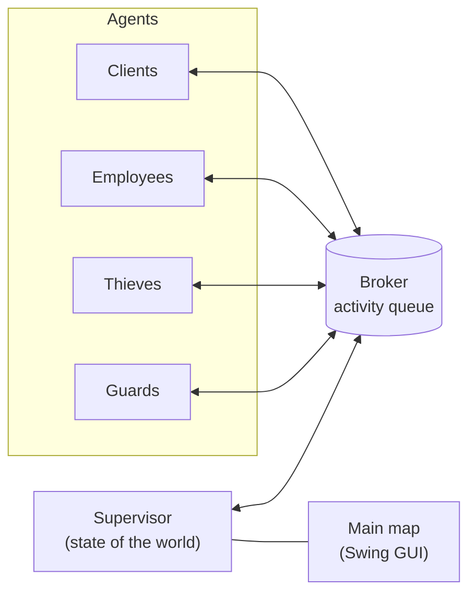
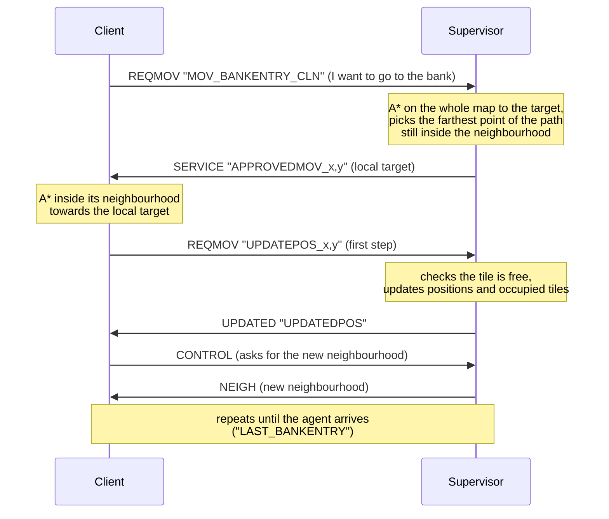

# Bank Robbery – Multi-agent simulation

A 2D tile-based simulation in **Java/Swing** where autonomous agents (clients, employees, thieves, guards)
move around a neighbourhood with a bank, a slot-machine hall and a police station, coordinated by a
**Supervisor** agent. Every agent runs in its own threads and talks to the others only by exchanging messages.

> The project started as a group assignment for a university course (2021) and is republished and
> reworked here as a portfolio piece. See [Project status](#project-status).

**▶ Live demo in the browser:** <https://lioneddu.github.io/bank-robbery-simulation/>, nothing to install
(see [Web demo](#web-demo)).

## Project goal

The goal was to design and build a **multi-agent system**: a set of autonomous programs, the *agents*, each
with a specific role. They share no memory and never call each other directly; the only way to cooperate is
to exchange messages through a broker. The overall behaviour (the bank opening, clients queuing, a robbery,
a chase) is not coded in a single place: it emerges from the interaction between agents.

The main technical topics covered:

- **Protocol design**: which messages (*activities*) exist, who sends them, who receives them and with what
  payload, so that agents written by different people can work together.
- **Concurrency**: each agent has several threads (decision making, message handling, heartbeat) that must
  stay in sync.
- **Shared state without shared memory**: two agents must never occupy the same tile, bank accounts must
  stay consistent, and the bank must open and close at the right time.
- **Partial knowledge**: each agent only sees its own neighbourhood but still has to reach far-away targets
  (two-level A*).
- **Lifecycle**: agents joining and leaving during the game, detection of vanished agents, clean shutdown.
- **Graphical interface** in Swing: the main map plus a small window for each agent.

## Scenario

- **Bank**: five counters with employees, a customer hall and a vault holding the account holders' money.
  Clients and thieves use the main entrance, employees use the staff entrance.
- **Slot-machine hall**: three slot machines where clients bet the money in their wallet.
- **Police station**: the guards' base, accessible only to them.
- **Outside**: streets, car parks and gardens where agents walk around.

The simulation ends when the bank runs out of money, because of robberies or withdrawals. All agents then
shut down and a *game over* screen appears.

## Agents

| Type | Code | Role |
|---|---|---|
| Supervisor | `SUP` | Loads and draws the map, keeps the state of the world (positions, occupied tiles, accounts), authorises movements and acts as referee. |
| Client | `CLN` | Deposits and withdraws money at the counter and plays the slot machines. When out of money it becomes *poor* and just walks around. |
| Employee | `EMP` | Goes to its desk, serves clients and walks to the vault to carry out their operations. |
| Thief | `THF` | Blends in with the clients, then robs the vault and escapes through the safest exit. |
| Guard | `GRD` | When the alarm goes off it enters the bank and chases the thieves, then brings back the recovered loot. |

Each agent perceives only its own **neighbourhood**, an NxN window around itself (5×5 by default,
configurable). It plans paths with **A\*** first towards a "big" target (the final destination) and then
towards a "small" target on the edge of its neighbourhood.

## How it works

### Overview



The **Supervisor** is the single authority on the state of the world. It knows the whole map, everyone's
position, the occupied tiles, the bank accounts, the counter queue and the robberies in progress. The other
agents never change anything on their own: they *ask* the Supervisor (to move, to join the queue, to
perform an operation), and it approves or refuses and updates the state. This way no locks are needed
between agents and no conflicts arise, such as two agents on the same tile.

### Agent lifecycle

Every agent follows the same pattern, inherited from the course's broker model:

1. **Subscribe**: at start-up it declares the activities it can perform (its *capabilities*).
2. **Engage**: in an endless loop it asks the broker for the next activity addressed to it and carries it out.
3. **Notify**: when done it reports the outcome (`COMPLETED` / `REFUSED`) and, in the same message, it can
   schedule new activities for other agents (`addNext`).
4. **Unsubscribe**: when it leaves the simulation.

Each agent uses three threads:

| Thread | Job |
|---|---|
| main | the *Engage → execute → Notify* loop: receives and runs activities |
| `OperationsThread` | decides what to do based on the agent's needs (withdraw, play slots, walk, rob…) and waits, with `wait`/`notify`, until the requests are fulfilled |
| `PresenceThread` | sends a heartbeat to the Supervisor every 5 seconds |

The Supervisor also runs a `ScannerThread`, which removes from the map the agents that have given no sign
of life for more than three intervals, and an `AlarmThread`, which flashes the bank lights during a robbery.

### Moving with partial knowledge

An agent only sees an NxN square around itself, so paths are computed on two levels:



If the target is unreachable or occupied, or the bank is closed, the Supervisor answers `REFUSED` and the
agent picks another action.

### A bank operation

1. The first employee to reach the staff entrance **opens the bank**. When no employee is left, the bank
   closes.
2. The client walks in, takes a ticket and asks the Supervisor to join the queue (`BANKQUEUE INSERTME`).
3. A free employee asks for the next client (`GIVEME`) and calls it to the counter (`YOURTURN`).
4. The client tells the employee the operation (withdrawal or deposit, and the amount). The employee has
   it checked by the Supervisor (`CHECKOP`), walks to the vault and comes back with the result, which
   updates the client's wallet and account balance.

### A robbery

1. The thief walks around like a client. At some point it enters the bank and reaches the vault.
2. The Supervisor takes the stolen amount from the accounts, notifies the account holders
   (`ROBBERYUPDATE`), raises the alarm and assigns the thief to a free guard (`ALARMGRD`).
3. The guard chases the thief: at every step it asks to move towards the thief's current position, which
   the Supervisor keeps updated during the escape.
4. If the guard catches it, the thief is removed (`KILL`); the guard deposits the loot at the police
   station's cash machine and the Supervisor redistributes it to the accounts. If the thief reaches its
   hideout instead, the robbery succeeds and the alarm stops.
5. If the bank runs out of money, the Supervisor sends `KILL` to everyone and shows the *game over* screen.

## Architecture

```
src/alloverdev/
├── Main.java            # launcher: starts the Supervisor, then all the other agents
├── Assets.java          # loads maps and images from the work/ folder (with caching)
├── WindowLayout.java    # window placement (main map + agents' mini GUIs)
├── broker/              # in-memory message bus (Connection, LocalBroker, Subscribe/Engage/Notify messages)
├── agents/              # Agent (abstract base), Supervisor, Client, Employee, Thief, Guard, AgentList
├── astar/               # A* algorithm (AStar, Cell)
├── interfaces/          # AgentsIF
├── maps/                # GUI: tile map (TileMap), agents layer (Glass/AgentMap), game window
├── operation/           # domain logic: Bank, Account, Robbery, Slot
└── exception/           # application exceptions
work/                    # runtime resources
├── Matrice_mappa.txt              # tile layout (numeric codes → Tiles/N.jpg)
├── Matrice_mappa_calpestabile.txt # 1 = walkable, 0 = obstacle, 2 = spawn point
├── Tiles/                         # 24x24 px tiles
├── Immagini_agenti/, Immagini_menu/
└── sample.properties              # legacy configuration (no longer needed)
src/simulation.properties          # activity names, bundled in the jar
web/                               # web demo page and local test server
tools/ConvertTiles.java            # converts the tiles to PNG for the web version
.github/workflows/pages.yml        # automatic build and deployment to GitHub Pages
```

- **Map**: a 30×48 grid of 24 px tiles (1152×720 window). Editing the two `.txt` matrices before start-up
  is enough to change the scenario.
- **Communication**: agents exchange *activities* (typed messages) through a publish/subscribe broker.
  Activity names are configurable and read from `simulation.properties`. Some examples: `SERVICE`
  (presence), `NEIGH` (neighbourhood), `REQMOV` (movement request), `BANKOP` and `REQOP` (bank
  operations), `THFPLAN` (thief's plan), `ALARM`, `KILL`.

### The in-memory broker

The `alloverdev.broker` package acts as the broker, using an activity-queue model:

- `SubscribeMessage` declares the activities an agent can perform. Without activities, it unsubscribes the
  agent.
- `NotifyMessage` closes the current activity and schedules new ones with `addNext(activity, payload, scope)`.
  The scope is `ANY` (any one agent able to perform it), `ALL` (all of them) or the login of a specific agent.
- `EngageMessage` takes the next activity assigned to the agent, waiting if there is none.

Each agent has its own mailbox (`LinkedBlockingQueue`), and its threads block while waiting without using
CPU. When an agent leaves (for example a caught thief) it calls `Connection.terminate()`: the agent
unsubscribes, closes its window and stops its threads, while the rest of the simulation keeps running.

## Build and run

You need a **JDK 11 or later** (for example [Eclipse Temurin](https://adoptium.net/)).

```bash
./build.sh            # on Windows: build.cmd
java -jar dist/bank-robbery.jar
```

The launcher starts the Supervisor and then, in the recommended order, employees and clients alternately,
the guard and the thieves. Each agent opens a small window showing its neighbourhood and its stats.
Maps and images are read from the `work/` folder, which is found automatically when the program is started
from the project folder or from `dist/`. Otherwise, pass it with `--workdir`.

Options:

| Option | Default | Meaning |
|---|---|---|
| `--clients N` | 3 | number of clients |
| `--employees N` | 2 | number of employees (there are 5 counters) |
| `--thieves N` | 2 | number of thieves |
| `--guards N` | 1 | number of guards |
| `--wallet EURO` | 0 | starting money in the clients' wallet |
| `--neighborhood N` | 5 | side of the neighbourhood, odd number between 3 and 27 |
| `--delay MS` | 1500 | pause between starting two agents |
| `--workdir DIR` | `work` | folder with maps and images |
| `--verbose` | – | prints the agents' logs to the console (very verbose) |
| `--debug` | – | like `--verbose`, plus every message exchanged |

To stop the simulation, close the map window: the Supervisor sends `KILL` to all agents and exits once
they have all left.

## Web demo

The same Swing application also runs in the browser thanks to [CheerpJ](https://cheerpj.com/), a JVM
compiled to WebAssembly. The jar is not modified: the `web/index.html` page loads CheerpJ from its CDN and
starts `bank-robbery.jar`, passing the resources folder with `--workdir`.

To try it locally you also need [Node.js](https://nodejs.org/), used only as a static file server:

```bash
./build-web.sh          # creates the site/ folder (page + jar + resources)
node web/serve.mjs      # then open http://localhost:8080/
```

Java's JPEG decoder relies on native code that is not available in the browser, so `build-web.sh`
converts the tiles to PNG with `tools/ConvertTiles.java`, keeping the same file names.

## Project status

In the original version every agent was a separate process communicating through a remote broker provided
by the course, which is no longer available. In this version the broker has been rewritten in memory with
the same interface, so the agents' logic is almost unchanged, and the whole simulation starts with a single
command.

### Roadmap

- [x] Replace the remote broker with a **local message bus** exposing the same interface.
- [x] Single launcher that starts all agents.
- [x] Browser demo with [CheerpJ](https://cheerpj.com/), deployable to GitHub Pages.
- [x] Lighter rendering (cached map) and console logs off by default.
- [ ] Buttons to add or remove agents while the simulation is running.
- [ ] Faster web demo (for example by preloading CheerpJ resources).
- [ ] Standard build with Maven or Gradle.
- [ ] Bring back the extra features: furniture editor, path tracker, "time machine" (state snapshots and
      restore), manual control of a client.
- [ ] Unit tests for A* and the banking logic.

## Credits

Original project developed as a group assignment for a university course (2021). The code has been cleaned
of personal references and is maintained and reworked in this repository.
